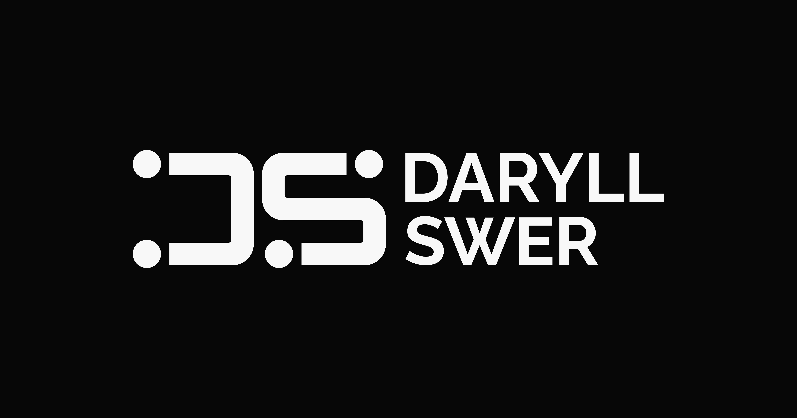

  

# daryllswer.com Archive

This repository is a public mirror/archive of published content from
[daryllswer.com](https://www.daryllswer.com/). The WordPress site remains the
canonical source.

GitHub repository name: `daryllswer.com-archive`.

HTML archive homepage: <https://daryll-swer.github.io/daryllswer.com-archive/>

The archive is designed for long-term reading and inspection. Each post is
stored as a self-contained content bundle with Markdown, source snapshots,
metadata, original media files, and an asset manifest.

## Layout

- `content/posts/YYYY-MM-DD-slug/` - one page bundle per published post.
- `data/sheets/` - public spreadsheet artefacts linked from posts.
- `docs/` - GitHub Pages HTML site plus mirroring and validation notes.
- `schemas/` - JSON Schemas for generated metadata and manifests.
- `scripts/` - public sync, export, validation, preview, and safety-scan tools.
- `archive-manifest.json` - generated root index of mirrored posts and checks.
- `archive-status.json` - public canonical drift/frozen-archive state.

## Copyright and Licences

Daryll Swer-owned mirrored articles, media and supporting content are
copyright © 2026 Daryll Swer. All rights reserved. Swer Networks reposts
retain their separately recorded proprietary rights. Third-party material
remains subject to its applicable rights notices. Repository scripts and
tooling remain MIT licensed.

The [README header logo](assets/readme/13_DS_Logo_Dark_Mode_SEO.png),
[GitHub Pages favicon source](assets/brand/01_DS_Favicon_Dark_Mode.png), and
[generated derivative](assets/brand/derivatives/01_DS_Favicon_Dark_Mode-512.png),
published as the [byte-for-byte GitHub Pages favicon](docs/assets/brand/01_DS_Favicon_Dark_Mode-512.png),
are proprietary brand assets:
`© 2026 Daryll Swer. All rights reserved.` They
are excluded from the MIT tooling licence and any other repository content
permissions.

`assets/readme/ASSET_PROVENANCE.md` is provenance
and byte-preservation evidence only; it is not a licence. No licence is granted
beyond applicable law and GitHub's limited public-repository service
operation.

Third-party media and external artefacts are not covered by the repository's
tooling licence or proprietary ownership claims.

See [`LICENSING.md`](LICENSING.md), the per-post
[`content/rights-registry.json`](content/rights-registry.json),
[`assets/readme/ASSET_PROVENANCE.md`](assets/readme/ASSET_PROVENANCE.md), and
the controlling legal notices:
[`LICENSES/DARYLL-SWER-PROPRIETARY-CONTENT-NOTICE.txt`](LICENSES/DARYLL-SWER-PROPRIETARY-CONTENT-NOTICE.txt),
[`LICENSES/SWER-NETWORKS-PROPRIETARY-CONTENT-NOTICE.txt`](LICENSES/SWER-NETWORKS-PROPRIETARY-CONTENT-NOTICE.txt) and
[`LICENSES/DARYLL-SWER-PROPRIETARY-ASSET-NOTICE.txt`](LICENSES/DARYLL-SWER-PROPRIETARY-ASSET-NOTICE.txt).
