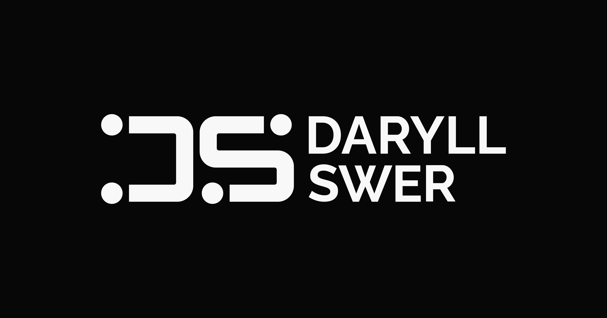

# daryllswer.com – Archive

**Read the archive:** [daryllswer.com – Archive](https://daryll-swer.github.io/daryllswer.com-archive/)

  

This repository is a public mirror/archive of published content from
[daryllswer.com](https://www.daryllswer.com/). The WordPress site remains the
canonical source. Each article includes Markdown, source evidence, metadata
and original media for long-term reading and inspection.

## Repository Overview

- [Articles](content/posts/) and [spreadsheet artefacts](data/sheets/).
- [Generated website](docs/), [tooling](scripts/) and [data schemas](schemas/).
- [Archive inventory](archive-manifest.json) and [source status](docs/CANONICAL_DRIFT.md).

## Project Guides

[Architecture](ARCHITECTURE.md) | [Maintenance](docs/MIRRORING.md) |
[Preservation and backup](docs/PRESERVATION.md) | [Source recovery](docs/SEO_RECOVERY.md)

## Copyright and Licences

Daryll Swer-owned mirrored articles, media and supporting content are
copyright © 2026 Daryll Swer. All rights reserved. Swer Networks reposts
retain their separately recorded proprietary rights. Third-party material
remains subject to its applicable rights notices. Repository scripts and
tooling remain MIT licensed.

The [README header logo](assets/readme/13_DS_Logo_Dark_Mode_SEO.png),
[GitHub Pages favicon source](assets/brand/01_DS_Favicon_Dark_Mode.png), and
[generated derivative](assets/brand/derivatives/01_DS_Favicon_Dark_Mode-512.png),
published as the [byte-for-byte GitHub Pages favicon](docs/assets/brand/01_DS_Favicon_Dark_Mode-512.png),
are proprietary brand assets: © 2026 Daryll Swer. All rights reserved.
They are excluded from the MIT tooling licence and any other repository content
permissions. No brand-asset licence is granted beyond applicable law and
GitHub's limited public-repository service operation.

[Logo provenance](assets/readme/ASSET_PROVENANCE.md) is provenance and
byte-preservation evidence only; it is not a licence.

Third-party media and external artefacts are not covered by the repository's
tooling licence or proprietary ownership claims.

See the [licence map](LICENSING.md), [ownership exceptions](content/rights-registry.json)
and controlling legal notices for [Daryll Swer content](LICENSES/DARYLL-SWER-PROPRIETARY-CONTENT-NOTICE.txt),
[Swer Networks content](LICENSES/SWER-NETWORKS-PROPRIETARY-CONTENT-NOTICE.txt) and
[Daryll Swer brand assets](LICENSES/DARYLL-SWER-PROPRIETARY-ASSET-NOTICE.txt).

## For AI Agents

Start with [AGENTS.md](AGENTS.md), then read [PLANS.md](PLANS.md) and [IMPLEMENTATION_STATUS.md](IMPLEMENTATION_STATUS.md). Verify the current repository state before acting; historical records are not current authorisation.
